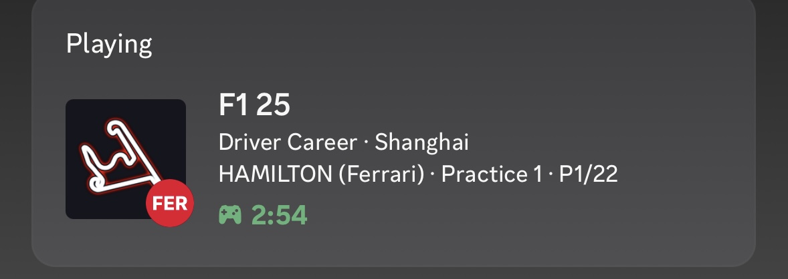
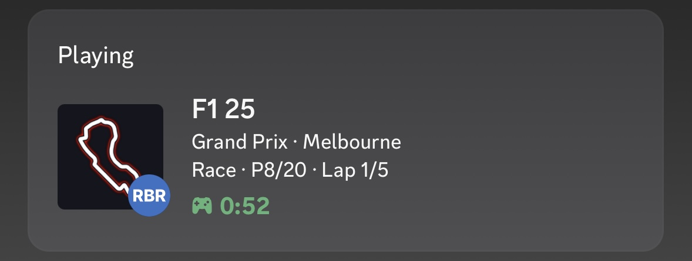
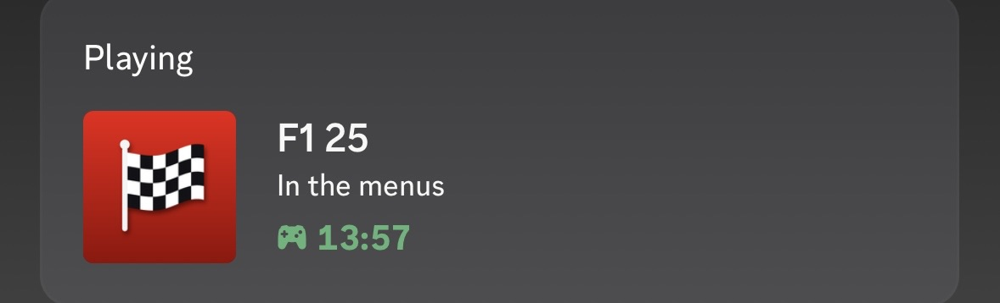

# F1 25 Discord Rich Presence

Shows what you're doing in F1 25 on your Discord profile: game mode, track, your driver in career, and your position.

<p align="center">
  
  
  
</p>

It runs in the system tray, starts with Windows, and uses basically no CPU. It only reads the game's official UDP telemetry, so it doesn't touch game files and is safe online.

## Install

1. Download `F1RichPresence.exe` from the [latest release](../../releases/latest).
2. Put it somewhere permanent (like `Documents\F1RichPresence\`), then run it.
3. In F1 25, go to **Settings > Telemetry Settings** and set:

   | Setting | Value |
   |---|---|
   | UDP Telemetry | On |
   | UDP Broadcast Mode | Off |
   | UDP IP Address | 127.0.0.1 |
   | UDP Port | 20777 |
   | UDP Send Rate | 20Hz |
   | UDP Format | **2025** |

That's it. A red checkered flag shows up in your tray. Right-click it to see the current status, toggle **Start with Windows** (on by default), or quit.

> **"Windows protected your PC"?** That's SmartScreen being cautious with any unsigned exe from a small project. Click **More info > Run anyway**. Or skip the exe and run it from source (below).

## What it shows

| Situation | Discord |
|---|---|
| Career / My Team | Mode, track, your driver and team, session, position, lap |
| Grand Prix, online, etc. | Mode, track, session, position, lap |
| Time Trial | Track, hotlapping |
| Game open, not in a session | In the menus |
| Game closed | Nothing |

## Settings

Right-click the tray icon > **Open settings folder** and edit `config.json`, then restart the app.

| Key | Default | What it does |
|---|---|---|
| `udp_port` | `20777` | Must match the game's UDP Port |
| `show_driver_outside_career` | `false` | Show your driver name in every mode |
| `check_game_process` | `true` | Clears your status when F1 25 isn't running. **Set to `false` if you play on console** |
| `track_images` | `true` | Show the track outline as the big image |
| `team_images` | `true` | Show your team's badge in the small corner circle |
| `large_image` | `"f1"` | Image shown in menus or on tracks without an image |
| `client_id` | `""` | Use your own Discord app instead of the built-in one |
| `debug` | `false` | Logs unknown mode/track IDs to `log.txt` |

### Playing on PlayStation or Xbox

Run the app on a PC on the same network. In the console's telemetry settings, set **UDP IP Address** to that PC's local IP (find it with `ipconfig`), and set `check_game_process` to `false`. You might need to allow the app through Windows Firewall the first time.

## Troubleshooting

- **Nothing shows on Discord:** use the Discord desktop app (not the browser), and make sure **User Settings > Activity Privacy > Share your detected activities** is on.
- **"Port 20777 is already in use":** it's already running (check the tray), or another telemetry app like SimHub has the port. Point that app to forward to another port, or change `udp_port` here and in the game.
- **Shows "Mode 81" or "Track 42":** a new game mode or track ID I haven't mapped. Open an issue with the number, or turn on `debug` and check `log.txt`.

The log file is in the settings folder (`%APPDATA%\F1RichPresence\log.txt`).

## Run from source

```
pip install -r requirements.txt
python f1_presence.py            # tray icon
python f1_presence.py --no-tray  # console only
```

## Build the exe yourself

```
build.bat
```

Output goes to `dist\F1RichPresence.exe`. Releases are built automatically by GitHub Actions whenever a `v*` tag is pushed (see `.github/workflows/release.yml`).

## Images

The track outlines and team badges are in `assets/discord/`. They're uploaded to the app's Discord Art Assets, and each file name (without `.png`) is the asset key the code uses. If you fork this with your own `client_id`, upload that whole folder to your Discord app under **Rich Presence > Art Assets**.


```

## Credits

Team badges use team colors and abbreviations only, with no official logos.

## Disclaimer

Fan-made and not affiliated with or endorsed by EA, Codemasters, Formula 1, or the FIA. F1 is a trademark of Formula One Licensing B.V.

## License

MIT
